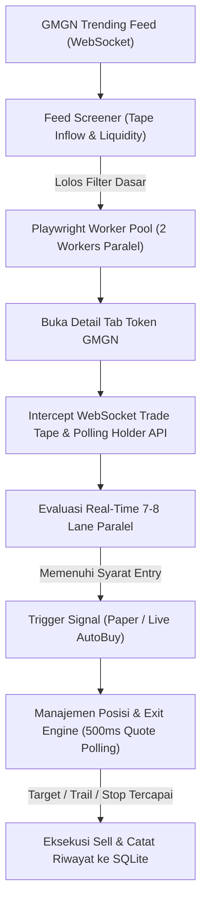

# 📖 Ringkasan Lengkap Proyek: Crypto Bot & Web Dashboard (7 Lanes & Multi-Strategy Rules)

Dokumen ini menyajikan panduan komprehensif mengenai arsitektur sistem, aturan teknis (*entry & exit rules*) untuk seluruh **7 Lane Strategi Perdagangan**, mekanisme dashboard web, eksekusi on-chain, serta tata kelola background service 24/7.

---

## 📑 Daftar Isi
1. [Arsitektur Sistem & Alur Kerja Bot](#1-arsitektur-sistem--alur-kerja-bot)
2. [7 Lane Strategi Perdagangan & Semua Aturannya](#2-7-lane-strategi-perdagangan--semua-aturnya)
   - [Plan 1: 🟢 Safe Aggressive (Live Baseline)](#plan-1--safe-aggressive-live-baseline)
   - [Plan 2: 🟣 Aggressive Optimal (Refined High-Win Filter)](#plan-2--aggressive-optimal-refined-high-win-filter)
   - [Plan 3: 🟠 Aggressive Wide (Anti-Shakeout Runner)](#plan-3--aggressive-wide-anti-shakeout-runner)
   - [Plan 7: 🌊 Aggressive Swing 100k (MC $10k–$100k Multi-Entry)](#plan-7--aggressive-swing-100k-mc-10k100k-multi-entry)
   - [Plan 8: ⚡ Aggressive Wave (Wave Maximizer)](#plan-8--aggressive-wave-wave-maximizer)
   - [Plan 4: 🔵 Momentum V2 (Classic 2x Snapshot Benchmark)](#plan-4--momentum-v2-classic-2x-snapshot-benchmark)
   - [Plan 5: ✨ Momentum V3 (Whale Confirm & Runner Hold)](#plan-5--momentum-v3-whale-confirm--runner-hold)
   - [*Bonus: 🟡 Momentum R5 Band (+5% s/d +10%) & ⚪ Control (Raw)*](#bonus--momentum-r5-band-5-sd-10--control-raw)
3. [Perbandingan Parameter 7 Lane (Matriks Komparasi)](#3-perbandingan-parameter-7-lane-matriks-komparasi)
4. [Arsitektur Dashboard Web & Semua Aturannya](#4-arsitektur-dashboard-web--semua-aturnya)
   - [Struktur Tab & Navigasi](#struktur-tab--navigasi)
   - [Mekanisme Pembaruan Data & Streaming Caching](#mekanisme-pembaruan-data--streaming-caching)
   - [Sistem AutoBuy & Integrasi On-Chain](#sistem-autobuy--integrasi-on-chain)
   - [PWA (Progressive Web App) & Cloudflare Tunnel](#pwa-progressive-web-app--cloudflare-tunnel)
5. [Manajemen Sesi 3 Jam & Background Service (Systemd)](#5-manajemen-sesi-3-jam--background-service-systemd)

---

## 1. Arsitektur Sistem & Alur Kerja Bot

Bot ini bekerja menggunakan arsitektur hybrid berbasis **Playwright Browser Automation** + **WebSocket Interception** + **Polling GMGN AMM Router**:



### Komponen Inti:
1. **Engine Kolektor & Playwright (`src/research-collector.ts`)**:
   - Membuka Chromium headful pada virtual display Xvfb (`:99`).
   - Mengelola pool worker independen (default 2 workers paralel).
   - Menangkap stream WebSocket GMGN secara real-time tanpa delay API pihak ketiga.
2. **Strategy Evaluator (`src/momentum-strategy.ts`)**:
   - Menghitung metrik mikro: *rolling return 5s/20s, buy inflow USD, buyer count, wallet dominance, dev holdings, top holder concentration*.
   - Mengevaluasi apakah token layak masuk (*entry gate*) dan kapan harus keluar (*exit gate*).
3. **Internal Router & Swap Route Poller**:
   - Berkomunikasi langsung dengan router AMM GMGN (`/defi/router/v1/sol/tx/get_swap_route`) setiap 500ms untuk mendapatkan harga riil setelah dipotong slippage, fee likuiditas, dan price impact.
4. **Database SQLite (`scripts/crypto-db.mjs`)**:
   - Mengarsipkan seluruh rekaman transaksi per sesi 3 jam ke database relasional SQLite (`data/crypto-runs.db`).

---

## 2. 7 Lane Strategi Perdagangan & Semua Aturannya

Setiap token yang masuk ke tab detail diuji secara bersamaan (*multi-lane comparison*) ke dalam 7 konfigurasi strategi:

---

### Plan 1: 🟢 Safe Aggressive (Live Baseline)
*Lane: `aggressive-safe` | Id: `safe`*
- **Tujuan**: Menangkap momentum breakout cepat dengan proteksi modal ketat.
- **Entry Rules**:
  - **Inflow Beli (5s)**: $\ge \$300$ dalam 5 detik terakhir.
  - **Dominasi Buyer Tertinggi**: $\le 70\%$ dari total volume 5 detik (mencegah pompaan 1 dompet/wash-trade).
  - **Jumlah Buyer Unik**: Minimal 4 pembeli berbeda dalam jendela 5 detik.
  - **Dev Holdings**: Maksimal **2.5%** dari total suplai (menghindari rug-pull developer).
  - **Sweet-Spot Market Cap**: Rentang **\$5,500 – \$15,000**.
  - **Holder Distribution**: Wajib terdistribusi sehat (lolos tiered holder gate).
- **Exit Rules**:
  - **Hard Stop**: **-3.0%** (cut-loss cepat jika momentum berbalik).
  - **Breakeven Lock**: Aktif begitu puncak profit mencapai **$\ge +7.5\%$**, memasang stop floor di **+3.5%**.
  - **Runner Trailing Stop**: Aktif jika profit menyentuh **$\ge +8.0\%$**, trailing sebesar **5%** dari puncak harga.
  - **Stagnasi**: Tutup posisi jika setelah **15 detik** profit belum mampu menembus $+2.5\%$.

---

### Plan 2: 🟣 Aggressive Optimal (Refined High-Win Filter)
*Lane: `aggressive-optimal` | Id: `optimal`*
- **Tujuan**: Lane rekomendasi utama dengan rasio kemenangan (*win-rate*) tertinggi melalui penyaringan ekstra ketat terhadap manipulasi supply dan lonjakan semu.
- **Entry Rules**:
  - **Inflow Beli (5s)**: $\ge \mathbf{\$400}$ (arus modal masuk lebih masif).
  - **Dominasi Buyer Tertinggi**: $\le \mathbf{50\%}$ (distribusi pembeli wajib sangat merata).
  - **Return 5s Maksimal**: $\le \mathbf{22.0\%}$ (Anti-Spike / Anti-FOMO di pucuk).
  - **Konsentrasi Top-1 Holder**: $\le \mathbf{6.0\%}$ (Anti-Dump: token ditolak jika ada paus pemilik $\ge 6\%$).
  - **Dev Holdings**: Maksimal $\mathbf{2.0\%}$.
  - **Order Flow 20s Buy Share**: $\ge \mathbf{65\%}$ (arus beli 20 detik wajib dominan di atas arus jual).
  - **Sweet-Spot Market Cap**: Rentang **\$5,500 – \$15,000**.
- **Exit Rules**:
  - **Hard Stop**: **-3.0%**.
  - **Breakeven Lock**: Aktif di puncak **$\ge +7.5\%$**, floor lock di **+3.5%**.
  - **Runner Trailing Stop**: Aktif di puncak **$\ge +8.0\%$**, trailing **5%** dari peak.
  - **Stagnasi**: 15 detik jika peak $< +2.5\%$.

---

### Plan 3: 🟠 Aggressive Wide (Anti-Shakeout Runner)
*Lane: `aggressive-wide` | Id: `wide`*
- **Tujuan**: Dirancang khusus untuk membiarkan token bernafas saat mengalami *micro-pullback* awal (-3% s/d -5%) agar tidak terkena cut-loss dini sebelum melonjak tinggi.
- **Entry Rules**:
  - Menggunakan kriteria ketat yang sama dengan **Aggressive Optimal**:
    - Inflow $\ge \$400$, Top Buyer $\le 50\%$, Max Return 5s $\le 22\%$, Dev $\le 2.5\%$, MC \$5.5k–\$15k.
- **Exit Rules**:
  - **Hard Stop Luas (Anti-Shakeout)**: **-6.0%** (tahan terhadap goyangan awal).
  - **Breakeven Lock**: Aktif di puncak $\ge +7.5\%$, floor lock di **+3.5%**.
  - **Runner Trailing Stop**: Aktif di puncak $\ge +8.0\%$, trailing **5%** dari peak.
  - **Stagnasi**: 15 detik jika peak $< +2.5\%$.

---

### Plan 7: 🌊 Aggressive Swing 100k (MC $10k–$100k Multi-Entry)
*Lane: `aggressive-swing-100k` | Id: `swing100k`*
- **Tujuan**: Menangkap gelombang token mapan yang sudah lolos fase micro-cap ($10k-$100k) dengan dukungan fitur *multi-entry re-trade* (bisa membeli kembali token yang sama pada siklus pump berikutnya).
- **Entry Rules**:
  - **Market Cap Band**: Rentang **\$10,000 s/d \$100,000**.
  - **Inflow Beli (5s)**: $\ge \$400$.
  - **Buy Share 5s**: Minimal **70%** volume adalah transaksi beli.
  - **Minimal Pembeli**: 4 buyer unik.
  - **Top 1 Holder**: $\le \mathbf{8.0\%}$ dari suplai.
  - **Dev Holdings**: $\le \mathbf{2.5\%}$.
  - **Max Entry Drawdown**: Maksimal 3.5% dari puncak lokal.
- **Exit Rules**:
  - **Hard Stop**: **-4.0%**.
  - **Breakeven Lock**: Aktif di puncak **$\ge +6.5\%$**, floor lock di **+3.5%**.
  - **Runner Trailing Stop**: Aktif di puncak **$\ge +9.0\%$**, trailing **5%** dari peak (floor lock minimal +6.0%).
  - **Stagnasi**: 20 detik jika peak $< +2.5\%$.
  - **Flow Exit**: Aktif jika arus jual mendominasi (sell share $> 75\%$ dan slope negatif).

---

### Plan 8: ⚡ Aggressive Wave (Wave Maximizer)
*Lane: `aggressive-wave` | Id: `wave`*
- **Tujuan**: **Memaksimalkan profit setinggi-tingginya** dengan menunggangi gelombang besar. Dilarang keluar di profit receh; target dihitung dinamis berdasarkan sejarah candle tertinggi (ATH) token.
- **Entry Rules**:
  - **Order Flow Buy Dominance**: $\ge \mathbf{60\%}$ transaksi adalah pembelian (keseimbangan buy/sell positif).
  - **Dev Holdings Toleran**: $\le \mathbf{3.5\%}$.
  - **Top 1 Holder**: $\le \mathbf{25.0\%}$ (memberi ruang bagi token dengan whale awal yang wajar).
  - **Jumlah Pembeli**: Minimal 3 pembeli.
  - **Inflow Beli**: $\ge \$300$ dalam 5 detik.
  - **Market Cap**: Rentang luas **\$10,000 s/d \$100,000**.
- **Exit Rules**:
  - **Target TP Dinamis (Analisis Sejarah ATH Token)**:
    - Bot membedah candle 1 menit GMGN (`/api/v1/token_mcap_candles/sol/{mint}`).
    - **Jika token pernah naik tinggi sebelumnya**: Target disetel sebesar **70% dari jarak ke rekor ATH masa lalu** (dibatasi maksimal **+150%**).
    - **Jika token breakout di ATH dengan candle impuls kuat ($\ge 30\%$)**: Target dinaikkan hingga **+40% s/d +100%**.
    - **Jika token baru / riwayat rendah**: Target mengunci batas aman **minimal +20.0%**.
  - **Runner Trailing Stop 5%**:
    - Aktif setelah profit mencapai **$\ge +18.0\%$**.
    - Mengunci keuntungan dengan toleransi trailing **5% dari titik puncak tertinggi** ($Floor = Peak \times 0.95$).
  - **Breakeven Protection**:
    - Aktif jika profit pernah menyentuh **$\ge +10.0\%$**, floor stop di **+3.0%**.
  - **Sabar Saat Turun (Dilarang Panik)**:
    - Toleransi penurunan luas dengan **Hard Stop -6.0%**.
    - Jendela stagnasi diperpanjang hingga **45 detik** agar posisi tidak tertutup sebelum gelombang kedua muncul.

---

### Plan 4: 🔵 Momentum V2 (Classic 2x Snapshot Benchmark)
*Lane: `momentum-v2` | Id: `v2`*
- **Tujuan**: Strategi momentum klasik teruji berbasis konfirmasi pertumbuhan pemegang token secara konsisten.
- **Entry Rules**:
  - **Konfirmasi 2x Holder Berturut-turut**: Jumlah holder unik bertambah pada 2 interval polling berturut-turut.
  - **Dev Holding**: $\le 2.5\%$.
  - **Market Cap**: \$5,500 – \$15,000.
- **Exit Rules**:
  - **Hard Stop**: **-20.0%**.
  - **Profit Target**: **+50.0%** (Take Profit Cap).
  - **Profit Lock**: Mengunci keuntungan di **+40.0%** jika momentum melemah.
  - **Major Holder Exit**: Otomatis jual jika terdeteksi holder papan atas melakukan aksi dumping.
  - **Polling Eksekusi**: Quote swap real-time 500ms via AMM Router GMGN.

---

### Plan 5: ✨ Momentum V3 (Whale Confirm & Runner Hold)
*Lane: `momentum-v3` | Id: `v3`*
- **Tujuan**: Pengembangan V2 yang dilengkapi konfirmasi arus paus (*Whale Confirmation Window*) dan kemampuan menahan posisi (*runner absorption hold*) saat order flow masih didominasi aksi beli.
- **Entry Rules**:
  - Filter V2 dasar + validasi arus volume akumulatif.
- **Exit Rules**:
  - **5s Whale Confirm**: Jika harga turun tetapi arus beli masih lebih besar daripada arus jual ($BuyFlow > SellFlow$), bot menahan posisi dan menolak cut-loss prematur.
  - **Runner Absorption Hold**: Melindungi posisi runner dari wick sesaat saat likuiditas menyerap aksi jual.
  - **Hard Stop**: -20.0% | **Profit Lock**: +40.0%.

---

### *Bonus: 🟡 Momentum R5 Band (+5% s/d +10%) & ⚪ Control (Raw)*
- **Plan 6: 🟡 Momentum R5 Band**:
  - **Entry**: Konfirmasi holder naik 2x, dengan syarat laju kenaikan harga 5 detik (`return5s`) berada ketat di rentang **+5.0% s/d +10.0%**. Mencegah masuk saat harga diam ($<+5\%$) atau saat harga sudah terlalu tinggi/overbought ($>+10\%$).
- **⚪ Control (Raw Aggressive)**:
  - Eksekusi simulasi tanpa filter dev/top-holder sebagai kelompok pembanding (*baseline benchmark*).

---

## 3. Perbandingan Parameter 7 Lane (Matriks Komparasi)

| Parameter | 🟢 Safe | 🟣 Optimal | 🟠 Wide | 🌊 Swing 100k | ⚡ Wave Maximizer | 🔵 V2 | ✨ V3 |
|---|---|---|---|---|---|---|---|
| **MC Min – Max** | \$5.5k–\$15k | \$5.5k–\$15k | \$5.5k–\$15k | **\$10k–\$100k** | **\$10k–\$100k** | \$5.5k–\$15k | \$5.5k–\$15k |
| **Min Inflow 5s** | \$300 | **\$400** | **\$400** | \$400 | \$300 | Volume stabil | Volume stabil |
| **Max Top Buyer** | 70% | **50%** | **50%** | 60% | 65% | — | — |
| **Max Dev Supply**| 2.5% | **2.0%** | 2.5% | 2.5% | 3.5% | 2.5% | 2.5% |
| **Max Top1 Holder**| Standard | **6.0%** | Standard | **8.0%** | 25.0% | LP Filtered | LP Filtered |
| **Order Flow Gate**| Standard | Flow20s $\ge$ 65% | Standard | BuyShare $\ge$ 70% | **BuyShare $\ge$ 60%** | — | Whale Flow |
| **Hard Stop** | -3.0% | -3.0% | **-6.0%** | -4.0% | **-6.0%** | -20.0% | -20.0% |
| **Breakeven Lock** | Peak $\ge$ +7.5% (+3.5%) | Peak $\ge$ +7.5% (+3.5%) | Peak $\ge$ +7.5% (+3.5%) | Peak $\ge$ +6.5% (+3.5%) | **Peak $\ge$ +10% (+3.0%)** | — | — |
| **Runner Trailing**| Peak $\ge$ +8% (5% trail) | Peak $\ge$ +8% (5% trail) | Peak $\ge$ +8% (5% trail) | Peak $\ge$ +9% (5% trail) | **Peak $\ge$ +18% (5% trail)** | — | Absorption |
| **Take Profit Target**| Mengikuti Trail | Mengikuti Trail | Mengikuti Trail | Mengikuti Trail | **Dinamis ATH (Min +20% s/d +150%)** | +50.0% | +50.0% |
| **Stagnation Exit**| 15s ($<+2.5\%$) | 15s ($<+2.5\%$) | 15s ($<+2.5\%$) | 20s ($<+2.5\%$) | **45s ($<+2.0\%$)** | — | — |
| **Re-trade Sama** | 1x per token | 1x per token | 1x per token | **Multi-Entry** | 1x per wave | 1x | 1x |

---

## 4. Arsitektur Dashboard Web & Semua Aturannya

Dashboard Web dapat diakses di **`http://localhost:4180`** (atau via tunnel publik Cloudflare). Script pengelola: [`scripts/serve-aggressive-dashboard-agy.mjs`](file:///home/bbliong/project/crypto-bot/scripts/serve-aggressive-dashboard-agy.mjs).

```
┌────────────────────────────────────────────────────────────────────────┐
│                        🔥 AGY AGGRESSIVE DASHBOARD                     │
├────────────────────────────────────────────────────────────────────────┤
│ [📊 Overview & Signals] [📈 Performa & Statistik] [🔍 Scanner] [💳 AutoBuy]
├────────────────────────────────────────────────────────────────────────┤
│ 7-PLAN SCORECARD CARDS (Real Win Rate, Net Profit $, Socket Score)    │
│ 🟢 Safe | 🟣 Optimal | 🟠 Wide | 🌊 Swing | ⚡ Wave | 🔵 V2 | ✨ V3  │
├────────────────────────────────────────────────────────────────────────┤
│ FILTER CHIPS BAR: [Semua] [🟣 Optimal] [🟠 Wide] [🌊 Swing] [⚡ Wave]... │
├────────────────────────────────────────────────────────────────────────┤
│ LIVE TRANSACTIONS TABLE (Token, Lane, Buy MC, Real Exit, AMM Route)   │
└────────────────────────────────────────────────────────────────────────┘
```

### Struktur Tab & Navigasi:
1. **Tab 1: 📊 Overview & Signal Monitor**:
   - **Multi-Lane Rules Banner**: Rangkuman visual aturan aktif untuk ke-7 strategi.
   - **Scorecard Komparasi Real-Time**: 7 kartu perbandingan performa (*Win Rate, Net Profit USD, Socket Score, Trap/Filter Notes*).
   - **Filter Chips Bar**: Tombol cepat untuk memfilter transaksi berdasarkan lane (`Semua`, `Optimal`, `Wide`, `Swing 100k`, `Wave Maximizer`, `Safe`, `V2`, `V3`).
   - **Tabel Riwayat Transaksi**: Detail lengkap per order mencakup nama token, mint, waktu, harga beli, peak profit %, harga jual riil (swap fill), alasan exit, dan rute swap AMM.
2. **Tab 2: 📈 Performa & Statistik**:
   - Visualisasi analitik performa kumulatif, drawdown, distribusi durasi trade, dan perbandingan performa per jam.
3. **Tab 3: 🔍 Scanner & Sinyal Aktif**:
   - Memantau token yang sedang berada di tab Playwright (Worker 1 & Worker 2).
   - Menampilkan status WebSocket streaming, deteksi liquidity, dan alasan mengapa token ditolak (*screen-rejected*).
4. **Tab 4: 💳 On-Chain & Auto-Buy**:
   - Panel kendali eksekusi live trade ke jaringan Solana via akun browser GMGN.

### Mekanisme Pembaruan Data & Streaming Caching:
- **Streaming Line Counts & Run Caching**: Dashboard menggunakan pembacaan parsial dan caching metadata (TTL 3 detik) untuk membaca ratusan megabyte log JSONL tanpa membuat server kehabisan memori atau lambat (*lag-free*).
- **Auto-Refresh**: Dashboard otomatis memperbarui tampilan setiap 10 detik tanpa perlu merefresh halaman browser manual.

### Sistem AutoBuy & Integrasi On-Chain:
Pengaturan AutoBuy tersimpan di [`config/autobuy-settings.json`](file:///home/bbliong/project/crypto-bot/config/autobuy-settings.json):
- **Lane Pemicu Live Buy (`activeLane`)**: Menentukan lane mana yang jika memicu sinyal BUY, bot akan langsung mengeksekusi pembelian riil di akun GMGN (misal `aggressive-optimal` atau `aggressive-wave`).
- **Modal Stake**: Pilihan mode USD (contoh: `$0.5`) atau SOL (contoh: `0.03 SOL`).
- **Slippage Control**: Setting slippage beli (contoh: `9%`) dan jual (contoh: `14%`).
- **Fee Prioritas & Tip Jito**: Pengaturan priority fee (contoh: `0.0001 SOL`) untuk memastikan transaksi masuk ke blok Solana dengan cepat dan terhindar dari frontrunning (*Anti-MEV*).
- **Auto-Sell**: Jika diaktifkan, saat bot mendeteksi kondisi exit pada lane terpilih, bot otomatis mengklik tombol jual (100%) di antarmuka GMGN.

### PWA (Progressive Web App) & Cloudflare Tunnel:
- **PWA Ready**: Mendukung *Add to Home Screen* pada perangkat smartphone Android/iOS lengkap dengan `manifest.json`, icon HD, dan service worker offline-first.
- **Cloudflare Tunnel (`scripts/run-dashboard-tunnel.mjs`)**: Membuat URL publik HTTPS otomatis sehingga dashboard dapat diakses dari mana saja tanpa membuka port router VPS.

---

## 5. Manajemen Sesi 3 Jam & Background Service (Systemd)

Bot dirancang untuk beroperasi secara mandiri dan tanpa henti (**24/7 continuous operation**).

### Pengaturan Systemd Daemon:
Dua unit service systemd aktif di level user (`~/.config/systemd/user/`):
1. **`crypto-bot-aggressive.service`**:
   - Menjalankan supervisor 2 worker (`scripts/run-aggressive-momentum-agy.mjs`).
   - `Restart=always` & `RestartSec=10`: Otomatis aktif kembali jika terjadi error atau koneksi terputus.
   - `Linger=yes`: Service tetap hidup meskipun sesi SSH ditutup.
2. **`crypto-bot-aggressive-dashboard.service`**:
   - Menjalankan web server dashboard pada port 4180.

### Mekanisme Rotasi Sesi 3 Jam Non-Stop:
Bot membagi data ke dalam folder sesi 3 jam (WIB: 00-03, 03-06, 06-09, 09-12, 12-15, 15-18, 18-21, 21-24):
1. **Deteksi Akhir Slot**: Saat waktu sesi berakhir, bot berhenti mengambil token baru.
2. **Graceful Draining**: Menunggu seluruh posisi terbuka dan order in-flight selesai dieksekusi (maksimal 120 detik).
3. **Auto-Archive SQLite**: Memanggil `syncSingleRunToSqlite()` untuk mengarsipkan seluruh metrik transaksi ke SQLite `data/crypto-bot.sqlite`.
4. **Auto-Rotate**: Jeda 3 detik, lalu loop supervisor langsung otomatis membuka sesi 3 jam berikutnya tanpa menghentikan bot.

---

## 6. Rincian Lengkap Database SQLite (`data/crypto-bot.sqlite`)

Sistem menggunakan SQLite bawaan Node.js (`node:sqlite` dengan mode WAL / Write-Ahead Logging) sebagai penyimpan data permanen berkecepatan tinggi.

Terdapat 6 tabel utama di dalam database `data/crypto-bot.sqlite`:

```
┌──────────────────────────────────────────────────────────┐
│                 DATABASE: crypto-bot.sqlite              │
├─────────────────┬────────────────────────────────────────┤
│ Tabel           │ Fungsi Utama                           │
├─────────────────┼────────────────────────────────────────┤
│ runs            │ Riwayat sesi 3-jam dan manifest        │
│ trades          │ Sinyal & simulasi trade (7 lane)       │
│ real_trades     │ Transaksi live on-chain Solana         │
│ route_quotes    │ Polling quote AMM real-time 500ms      │
│ app_settings    │ Konfigurasi runtime & AutoBuy          │
│ token_metadata  │ Profil & kapitalisasi pasar token      │
└─────────────────┴────────────────────────────────────────┘
```

---

### A. Tabel `runs` (Manajemen Sesi)
- **Tujuan**: Mencatat metadata setiap sesi pengamatan (3 jam per folder sesi).
- **Kapan Dimasukkan / Diperbarui**:
  - Dibuat saat sesi baru dimulai (`upsertRun`).
  - Diperbarui saat sesi berakhir untuk merekam jumlah total trade (`trades_count`) dan status penutupan.
- **Rincian Field**:
  | Kolom | Tipe | Keterangan |
  |---|---|---|
  | `id` | `TEXT` [PK] | ID unik sesi (misal: `momentum-aggressive-2026-10-02T23-00-00-000Z`) |
  | `path` | `TEXT` | Path folder sesi di disk (`research/...`) |
  | `started_at` | `TEXT` | Timestamp ISO awal sesi dimulai |
  | `friendly_label`| `TEXT` | Label jam WIB (misal: `06:00 - 09:00 WIB`) |
  | `is_live` | `INTEGER` | `1` jika live auto-buy aktif, `0` jika paper mode |
  | `trades_count` | `INTEGER` | Total transaksi yang tercatat dalam sesi ini |
  | `manifest_json`| `TEXT` | JSON konfigurasi mesin browser, channel, dan setting worker |
  | `strategy_json`| `TEXT` | JSON aturan strategi yang aktif pada sesi tersebut |
  | `created_at` | `TEXT` | Waktu baris pertama kali dibuat di database |
  | `updated_at` | `TEXT` | Waktu pembaruan terakhir data sesi |

---

### B. Tabel `trades` (Paper & Simulated Trades 7 Lane)
- **Tujuan**: Merekam setiap posisi trading simulasi pada seluruh lane (Safe, Optimal, Wide, Swing, Wave, V2, V3) dari saat Buy hingga Sell.
- **Kapan Dimasukkan / Diperbarui**:
  - **Saat Entry (Buy)**: Baris dibuat dengan status `OPEN`, mencatat `entry_price`, `entry_time`, dan parameter lane.
  - **Saat Exit (Sell)**: Baris di-update menjadi `CLOSED`, mengisi `exit_price`, `exit_time`, `exit_reason`, PnL, dan rute swap.
- **Rincian Field**:
  | Kolom | Tipe | Keterangan |
  |---|---|---|
  | `id` | `TEXT` [PK] | ID komposit unik (`runId:mint:lane:entryTime`) |
  | `run_id` | `TEXT` | Relasi ke tabel `runs(id)` |
  | `position_id` | `TEXT` | ID posisi internal bot |
  | `mint` | `TEXT` | Alamat kontrak token Solana (CA) |
  | `symbol` | `TEXT` | Ticker token (misal: `PEXRA`) |
  | `name` | `TEXT` | Nama lengkap token |
  | `lane` | `TEXT` | Kode lane (`aggressive-optimal`, `aggressive-wave`, dll.) |
  | `lane_label` | `TEXT` | Label tampilan UI (misal: `Wave Maximizer`, `Optimal Aggressive`) |
  | `worker` | `INTEGER` | Nomor worker Playwright yang mengeksekusi (1 atau 2) |
  | `status` | `TEXT` | Status posisi: `OPEN` atau `CLOSED` |
  | `entry_price` | `REAL` | Harga token saat sinyal beli valid (USD) |
  | `entry_time` | `INTEGER` | Timestamp milidetik saat beli |
  | `exit_price` | `REAL` | Harga token saat sinyal jual terpicu (USD) |
  | `exit_time` | `INTEGER` | Timestamp milidetik saat jual |
  | `duration_sec` | `INTEGER` | Lama waktu posisi terbuka (detik) |
  | `exit_reason` | `TEXT` | Alasan keluar (`AGGRESSIVE_WAVE_TARGET_TP`, `AGGRESSIVE_RUNNER_TRAIL`, `AGGRESSIVE_HARD_STOP`, dll.) |
  | `trade_return_percent`| `REAL` | Persentase profit/rugi berdasarkan harga WebSocket |
  | `socket_return_percent`| `REAL` | Identik dengan return mentah WebSocket |
  | `real_return_percent` | `REAL` | Return bersih setelah dipotong estimasi slippage & fee AMM Router |
  | `trade_pnl_usd` | `REAL` | Keuntungan/kerugian kotor dalam USD |
  | `swap_pnl_usd` | `REAL` | Keuntungan/kerugian bersih berdasarkan kuotasi rute AMM nyata |
  | `is_win` | `INTEGER` | `1` jika profit $> 0$, `0` jika loss |
  | `is_socket_win` | `INTEGER` | `1` jika return WebSocket $> 0$ |
  | `is_real_win` | `INTEGER` | `1` jika return AMM riil $> 0$ |
  | `swap_route_json` | `TEXT` | Detail JSON breakdown rute swap: input SOL, output token, slippage beli & jual |

---

### C. Tabel `real_trades` (Live On-Chain Solana Execution)
- **Tujuan**: Merekam setiap transaksi uang riil yang dieksekusi di akun GMGN via dompet Solana browser.
- **Kapan Dimasukkan / Diperbarui**:
  - **Saat Beli Riil**: Dicatat saat klik beli live berhasil dikirim (`BROWSER_BUY_SUBMITTED`), mencatat TX Hash, Solscan URL, dan saldo terpotong.
  - **Saat Jual Riil**: Di-update saat bot mengklik tombol sell di GMGN (`BROWSER_SELL_SUBMITTED`), mencatat income SOL yang diterima dan PnL riil dompet.
- **Rincian Field**:
  | Kolom | Tipe | Keterangan |
  |---|---|---|
  | `id` | `TEXT` [PK] | ID unik trade riil (`real:runId:mint:buyTime`) |
  | `run_id` | `TEXT` | Relasi ke `runs(id)` |
  | `mint` | `TEXT` | Alamat kontrak token (CA) |
  | `symbol` / `name` | `TEXT` | Identitas token |
  | `lane` / `lane_label` | `TEXT` | Lane pemicu pembelian live |
  | `status` | `TEXT` | `HOLDING` (sedang dipegang) atau `CLOSED` (selesai dijual) |
  | `buy_time` | `INTEGER` | Timestamp eksekusi beli di blockchain |
  | `buy_ok` | `INTEGER` | `1` jika order sukses dikonfirmasi GMGN, `0` jika gagal |
  | `buy_order_id` | `TEXT` | ID order dari router GMGN |
  | `buy_hash` | `TEXT` | Signature transaksi on-chain Solana |
  | `buy_solscan_url` | `TEXT` | Link verifikasi Solscan untuk transaksi beli |
  | `buy_stake_usd` | `REAL` | Modal yang dialokasikan (misal: \$0.5) |
  | `buy_token_price_usd`| `REAL` | Harga token saat order masuk |
  | `buy_acquired_amount`| `TEXT` | Jumlah unit token yang berhasil dibeli |
  | `sell_time` | `INTEGER` | Timestamp eksekusi jual di blockchain |
  | `sell_ok` | `INTEGER` | `1` jika transaksi jual berhasil |
  | `sell_order_id` / `sell_hash` | `TEXT` | ID order dan TX Hash Solana transaksi jual |
  | `sell_solscan_url`| `TEXT` | Link Solscan untuk transaksi jual |
  | `sell_token_price_usd`| `REAL` | Harga token saat penjualan berhasil |
  | `duration_sec` | `INTEGER` | Lama waktu memegang token on-chain |
  | `theory_return_percent`| `REAL` | Perkiraan persentase profit sebelum eksekusi |
  | `actual_return_percent`| `REAL` | Persentase profit riil yang masuk ke dompet |
  | `slippage_diff_percent`| `REAL` | Selisih slippage antara harga layar vs eksekusi on-chain |
  | `wallet_buy_cost` | `REAL` | Total SOL/USD yang terpotong saat beli |
  | `wallet_sold_income` | `REAL` | Total SOL/USD yang masuk kembali setelah jual |
  | `wallet_pnl_usd` | `REAL` | Keuntungan/kerugian bersih riil di dompet pengguna |
  | `wallet_snapshots_json`| `TEXT` | Snapshot saldo dompet sebelum & sesudah trade |
  | `buy_payloads_json` / `sell_payloads_json` | `TEXT` | Payload API mentah GMGN untuk audit teknis |

---

### D. Tabel `route_quotes` (Polling Kuotasi Swap AMM 500ms)
- **Tujuan**: Merekam hasil polling harga riil langsung dari endpoint AMM GMGN (`/defi/router/v1/sol/tx/get_swap_route`).
- **Kapan Dimasukkan**:
  - Dimasukkan **secara berkala (setiap 500ms)** saat sebuah token sedang aktif dipantau di tab worker Playwright.
- **Rincian Field**:
  | Kolom | Tipe | Keterangan |
  |---|---|---|
  | `id` | `INTEGER` [PK] | ID auto-increment |
  | `run_id` | `TEXT` | Relasi ke sesi pengamatan |
  | `observed_at` | `INTEGER` | Timestamp kuotasi diambil (ms) |
  | `mint` | `TEXT` | Alamat kontrak token |
  | `type` | `TEXT` | Tipe kuotasi: `QUOTE_BUY_COMPARISON` atau `QUOTE_SELL_COMPARISON` |
  | `type_label` | `TEXT` | Label: `Buy Route` atau `Sell Route` |
  | `signal_price_usd` | `REAL` | Harga token menurut WebSocket feed |
  | `route_implied_token_price_usd` | `REAL` | Harga riil jika dieksekusi via pool AMM (setelah fee) |
  | `slip_percent` | `REAL` | Persentase deviasi/slippage antara router vs feed WebSocket |
  | `latency_ms` | `INTEGER` | Kecepatan respons endpoint router GMGN (milidetik) |
  | `input_amount_base_units` | `TEXT` | Nilai input dalam satuan terkecil (lamports / token base) |
  | `route_token_amount` | `REAL` | Jumlah token yang akan didapat / dijual |
  | `raw_quote_json` | `TEXT` | Respons utuh JSON dari router GMGN (termasuk rute pool Raydium/Pump/Meteora) |

---

### E. Tabel `app_settings` (Konfigurasi Aplikasi)
- **Tujuan**: Menyimpan pengaturan fleksibel bot yang dapat diubah langsung dari Dashboard Web tanpa restart service.
- **Kapan Dimasukkan / Diperbarui**:
  - Di-update seketika saat pengguna menekan tombol **"Simpan Pengaturan"** di tab AutoBuy atau memilih preset filter Market Cap di dashboard.
- **Rincian Field**:
  | Kolom | Tipe | Keterangan |
  |---|---|---|
  | `key` | `TEXT` [PK] | Kunci konfigurasi (misal: `autobuy_settings`, `feed_settings`) |
  | `value` | `TEXT` | Nilai pengaturan dalam format string JSON |
  | `updated_at` | `TEXT` | Timestamp ISO perubahan pengaturan |

---

### F. Tabel `token_metadata` (Kamus Metadata Token)
- **Tujuan**: Menyimpan cache identitas token agar dashboard tidak perlu memanggil API GMGN berulang kali.
- **Kapan Dimasukkan / Diperbarui**:
  - Dimasukkan saat token pertama kali lolos screening awal di feed WebSocket.
- **Rincian Field**:
  | Kolom | Tipe | Keterangan |
  |---|---|---|
  | `mint` | `TEXT` [PK] | Alamat kontrak token |
  | `symbol` | `TEXT` | Ticker (contoh: `SOL`, `PEXRA`) |
  | `name` | `TEXT` | Nama token |
  | `decimals` | `INTEGER` | Desimal token (biasanya 6 pada token Solana) |
  | `market_cap_usd` | `REAL` | Kapitalisasi pasar token saat terdeteksi |
  | `updated_at` | `INTEGER` | Timestamp data terakhir diperbarui |

